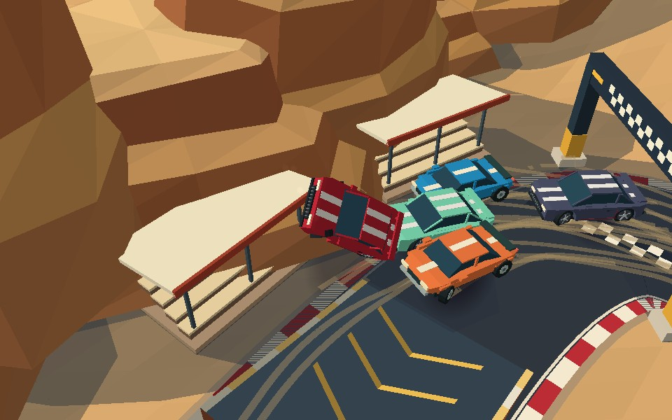
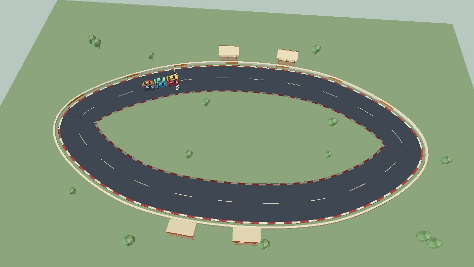

# StuntBox

**Build tracks. Simulate car chases. Capture cinematic stunts.**

StuntBox is a browser-based 3D automotive sandbox for designing circuits, experimenting with vehicle physics and creating short action videos. It combines a track editor, autonomous driving and a cinematic camera system in a single workspace.

*In-engine preview from an earlier development version.*

## Features

- **Track editor:** reshape roads and independently edit waypoints that guide autonomous drivers.
- **Stunt construction:** place ramps, obstacles and grouped props. Configure their orientation, scale, height, mass and whether they are fixed or movable.
- **Simulation:** stock-car races, rally runs and police pursuits with physical collisions.
- **Built-in tracks:** Speedway, Straight Line, S-bend, Small Oval, Sierra Cobre, Marseille and Police#1.
- **Cinematic cameras:** helicopter, rear chase, aerial and free cameras.
- **Video capture:** landscape or vertical recording with sound; Police#1 also supports a two-camera vertical composition (WebGL required). The recording target is 1080 × 1920 in portrait; actual performance depends on the device.
- **Local circuit files:** export and import JSON to save, edit and share your own circuits without an account or server-side storage.

## Videos made with StuntBox

Explore six short videos showcasing the project:

- [Showcase 1 — YouTube Short](https://www.youtube.com/shorts/VwrfskYhOe4)
- [Showcase 2 — YouTube Short](https://www.youtube.com/shorts/0-suQTIKrIk)
- [Showcase 3 — YouTube Short](https://www.youtube.com/shorts/795XVmw1w1M)
- [Showcase 4 — YouTube Short](https://www.youtube.com/shorts/F7mk4tNNPdA)
- [Showcase 5 — YouTube Short](https://www.youtube.com/shorts/w2GNT-W4Bno)
- [Showcase 6 — YouTube Short](https://www.youtube.com/shorts/ykCwd2LsyDs)

## Getting started

1. Download the StuntBox ZIP archive.
2. Extract the entire archive to a folder on your computer.
3. Double-click **`index.html`** to launch StuntBox in a recent desktop browser with WebGL support.

That's it. No server, installation, account, API key or internet connection is required. Keep the extracted files and folders together.

## Create your first circuit

1. Choose a track in **Scene → Track**. The editor starts in **Waypoints**, which controls the cars' trajectory.
2. Drag a waypoint to adjust the driving line. Switch to **Road** to reshape the road, **Ramps** for ramps, or **Obstacles / Groups** for props.
3. Configure the vehicles, target speed and simulation mode in the right-hand panel.
4. Click **Simulation** in the header and choose your camera and output format.
5. Click **Record** to capture a video, or use **Import / Export** to save the circuit itself.

The interface and documentation are in English.

| Editor control | Action |
| --- | --- |
| Drag empty space | Orbit the camera |
| Shift + drag | Pan |
| Mouse wheel | Zoom |
| Drag a numbered point | Move a road point or waypoint |
| Frame track | Frame the track |
| Insert / Remove / ↶ | Add, remove or undo |

*Earlier in-engine overview of a circuit.*

## Save and share

Use **Import / Export → Export circuit** to download a JSON file to your computer. The file stores the track geometry, waypoints, placed props and simulation settings. Import it later via **Import circuit** to continue editing. Export any changes you want to keep before loading another file.

Circuit JSON is separate from the recorded video. Files are processed locally by the studio.

## Police#1: cinematic pursuit

Police#1 is a scripted 25-second urban pursuit with autonomous vehicles, obstacles and multiple camera options.

- Select **Police#1** and launch **Simulation**.
- Choose **Helicopter chase #2** for the centered chase camera.
- Select **Dual-camera short · 9:16** for a synchronized hood camera and helicopter view, separated by a diagonal line.
- Select **Record** to record the sequence.

## Project structure

| Path | Purpose |
| --- | --- |
| `index.html` | Main studio interface |
| `studio.css` | Material-inspired UI |
| `js/core/` | Simulation orchestration, track data and object registry |
| `js/editor/` | Track editing and circuit file validation |
| `js/physics/` | Vehicle physics and autonomous driving |
| `js/scenes/` | Canyon, Marseille and Police#1 scenes |
| `js/world/` | Reusable scenery and terrain |
| `js/rendering/` | Renderer, cameras, lighting and effects |
| `js/vehicles/` | Vehicle models |
| `js/audio/` | Audio engine |
| `js/capture/` | Video recording |
| `js/ui/` | Studio interface controller |
| `vendor/` | Local third-party dependencies and their licenses |
| `js/local/` | Bundled browser modules for offline launch |
| `tools/build-local.cjs` | Optional developer tool to rebuild the offline modules |
| `Apercus/` | Existing in-engine preview images |

## Technology

- JavaScript, HTML and CSS
- Three.js 0.170.0 for 3D rendering
- Rapier 0.17.3 for physics
- Canvas, Web Audio and MediaRecorder for capture

## Development

The editable ES modules live in `js/`. The files in `js/local/` are generated for direct offline launch; do not edit them manually. After changing a module, run `node tools/build-local.cjs` from the project folder to synchronize the offline version. Node.js is only needed by developers, not by players. Use `node tools/build-local.cjs --check` to verify that the generated offline files match the editable sources. The embedded libraries and legacy circuit-format identifier are retained for compatibility.

## Contributing

This is an experimental project in active development. Bug reports, reproducible test cases, performance improvements and new circuit ideas are welcome. Include your browser, operating system, selected circuit and a screenshot or short recording when reporting a visual issue.

## License and credits

The existing source license is [MIT](LICENSE.txt). Third-party libraries and audio retain their own licenses, including Creative Commons licenses for some sounds. See [CREDITS.md](CREDITS.md) and the notices in `vendor/` before redistributing assets or publishing recordings.

A full asset-license audit is still recommended before redistribution.
